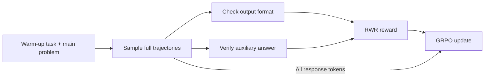

# Reasoning Warm-up: Scaling Label-free RL via Verifiable Surrogate Rewards

**NeurIPS 2026**

Jun Nie<sup>1,2</sup>, Bo Han<sup>2</sup>, Jiaqi Fan<sup>3</sup>, Yonggang Zhang<sup>4</sup>, Xinmei Tian<sup>1</sup>, Dahai Yu<sup>3</sup>, Michael Ng<sup>2</sup>

<sup>1</sup>University of Science and Technology of China · <sup>2</sup>Hong Kong Baptist University  
<sup>3</sup>TCL Corporate Research (HK) Co., Ltd. · <sup>4</sup>The Hong Kong University of Science and Technology, HKGAI

> **Verify the warm-up. Reinforce the reasoning.**  
> Reasoning Warm-up Reinforcement Learning (**RWR**) turns an automatically verifiable auxiliary task into a reward for the **entire reasoning trajectory**, without using the main problem's ground-truth answer during RL optimization.

[Core idea](#core-idea) · [Reward and optimization](#reward-and-optimization) · [Results](#results) · [Code release](#code-release) · [Citation](#citation)

## Core idea

**Where can RL get a useful reward when the main-task answer is unavailable?**

Agreement alone is not enough: a model can generate several solutions that are consistent with one another but all wrong. RWR introduces a different source of feedback—a short, deterministic auxiliary task that can be checked exactly by a program.

The model solves this **warm-up task first**, then continues with the original reasoning problem in the same response. Our motivating observation is that trajectories with successful auxiliary reasoning are more likely to solve the subsequent main problem than trajectories with unsuccessful auxiliary reasoning. We call this association **Reasoning Warm-up**.

The auxiliary task is **not a decomposition of the main problem**, and its construction does not require the main answer. Its purpose is to provide an observable signal for selecting and reinforcing full reasoning trajectories.

<details>
<summary><strong>A concrete warm-up example</strong></summary>

An illustrative two-part prompt:

```text
Task 1 — Warm-up
Read the sequence: 820, 937, 820, 515, 123, 755, 783, 353, 544.
Count from the end and return the 6th number inside <aux>...</aux>.

Task 2 — Main problem
Solve the original mathematical reasoning problem.
Put its final answer inside \boxed{...}.
```

For Task 1, the verifier computes the target `515` directly from the sequence. It can therefore check `<aux>515</aux>` without knowing the answer to Task 2.

The paper also studies other programmatically generated auxiliary tasks, including summing numbers and finding a maximum. The main experiments use memory-based auxiliary tasks.

</details>

## Reward and optimization

RWR changes **where the reward comes from** while using GRPO-style policy optimization.



For each auxiliary–main trajectory $\tau$, let $F(\tau)$ indicate valid output format and $A(\tau)$ indicate a correct auxiliary answer. The reward is

$$
R(\tau)=F(\tau)\left(\frac{1}{2}+\frac{1}{2}A(\tau)\right).
$$

| Output format | Auxiliary answer | Reward |
| :--- | :--- | :---: |
| Invalid | Not evaluated | 0 |
| Valid | Incorrect | 0.5 |
| Valid | Correct | 1 |

The format check validates the required answer fields; **it does not verify the main answer's correctness**.

For each main problem, RWR samples a group of trajectories, computes group-relative advantages from these rewards, and applies each trajectory's advantage to **all its generated tokens**, including the main-task continuation. The auxiliary task is therefore neither a separate pretraining objective nor just an inference-time prompt: its verification outcome supplies the learning signal for the combined response.

**Label-free refers to the main-task answer labels.** Auxiliary targets are generated automatically and checked exactly. Their usefulness as surrogate rewards depends on alignment between auxiliary success and downstream reasoning quality.

## Results

The paper studies MATH and DAPO-14k as training sets. Evaluation covers mathematical reasoning on **MATH500, GSM8K, AMC, and AIME24**, as well as instruction following and broader knowledge on **IFEval and MMLU-Pro**.

### Selected results: MATH500 and GSM8K

Reported pass@1 accuracy (%) after training on **MATH**. Each entry shows **before RL → RWR**, transcribed from the manuscript's main comparison table.

| Backbone | MATH500 | GSM8K |
| :--- | :---: | :---: |
| Qwen3-8B-Base | 72.40 → **80.80** | 27.82 → **93.18** |
| Qwen2.5-7B | 60.20 → **66.60** | 24.71 → **88.66** |
| Llama-3.2-3B-Instruct | 39.20 → **48.20** | 65.73 → **79.23** |

Main-task ground-truth answers are withheld from **RWR reward computation**, not from evaluation. The paper also compares against Self-Certainty, Entropy, Majority Voting, Co-rewarding, and a ground-truth-reward reference.

<details>
<summary><strong>Reward ablation: is format reward alone enough?</strong></summary>

Qwen3-8B-Base trained on MATH; reported pass@1 accuracy (%) on the same two benchmarks.

| Reward variant | MATH500 | GSM8K |
| :--- | :---: | :---: |
| Full RWR reward | **80.80** | **93.18** |
| Without auxiliary reward | 62.80 | 86.66 |
| Without format reward | 75.60 | 91.58 |

Removing the auxiliary reward reduces performance on both benchmarks. In this experiment, encouraging valid output format alone does not recover the gains of the full reward.

</details>

## Code release

**Code coming soon.** Training and evaluation code, configurations, and usage instructions will be added here with the implementation.

## Citation

```bibtex
@misc{nie2026reasoningwarmup,
  title  = {Reasoning Warm-up: Scaling Label-free RL via Verifiable Surrogate Rewards},
  author = {Nie, Jun and Han, Bo and Fan, Jiaqi and Zhang, Yonggang and Tian, Xinmei and Yu, Dahai and Ng, Michael},
  year   = {2026}
}
```

Questions about the method or code release can be raised in [GitHub Issues](https://github.com/junnie00/RWR/issues).
